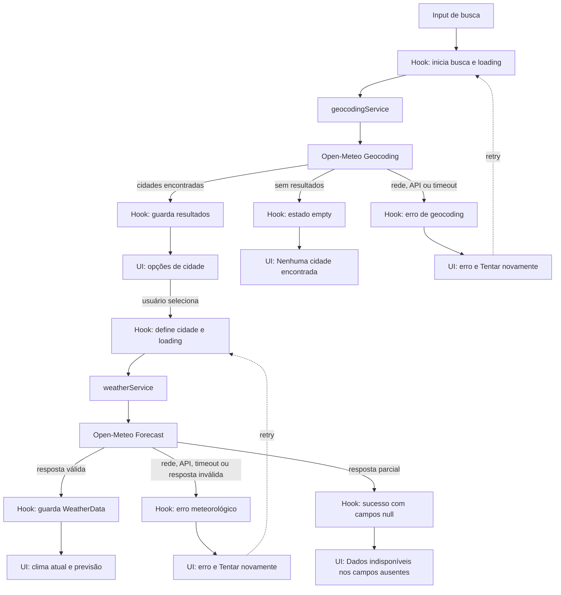

# Plano Técnico: Weather App

Este plano deriva de [`specs/weather-app-spec.md`](../specs/weather-app-spec.md). Ele define decisões e contratos para orientar as tarefas de implementação; os campos meteorológicos marcados como provisórios continuam sujeitos à aprovação descrita na spec.

## Architecture

A aplicação será uma SPA responsiva organizada em camadas. A direção principal das dependências é `components -> hooks -> services`; `lib` contém funções puras reutilizadas sem acessar rede ou estado React, e `types` contém contratos compartilhados.

```text
Busca e seleção (React)
				|                     Unidade (React)
				v                           |
useWeather / estado da tela         | conversão de apresentação
				|
				+--> geocodingService --> Open-Meteo Geocoding API
				+--> weatherService ----> Open-Meteo Forecast API
				|
				v
Modelo de domínio normalizado --> componentes de resultado
```

Responsabilidades e fronteiras:

- `components` apresenta busca, opções de cidade, clima, previsão e feedback; recebe estado e callbacks, sem conhecer `fetch` ou o formato da API.
- `hooks` orquestra estado da tela, seleção, carregamento, retry e descarte de respostas obsoletas; chama serviços sem implementar transporte HTTP.
- `services` monta URLs/parâmetros, executa `fetch`, timeout e validação de resposta; converte a resposta externa ao domínio usando mapeadores puros.
- `lib` contém conversões de temperatura, formatação de datas, descrições WMO e mapeadores determinísticos; não depende de React, rede ou estado global.
- `types` define modelos de domínio e formatos externos para manter contratos explícitos entre camadas.

Essa separação deixa cada regra testável no nível em que vive: apresentação por interação/renderização, orquestração por estados e serviços simulados, acesso a dados com `fetch` controlado e funções de `lib` com entradas/saídas determinísticas. As camadas inferiores não importam componentes ou hooks.

## Tech Stack

- **TypeScript strict:** contratos explícitos para domínio e respostas externas.
- **React + Vite:** SPA e servidor/build de desenvolvimento já adotados pelo projeto.
- **Tailwind CSS:** estilos responsivos seguindo a base visual do projeto.
- **Open-Meteo:** geocodificação e previsão sem chave de API, conforme FR-01 a FR-04.
- **Vitest + Testing Library:** testes unitários e de componentes; **Playwright:** fluxos E2E.
- **pnpm + Biome:** gerenciamento de dependências, lint e formatação existentes.

Não adicionar biblioteca de estado global nem camada de cache: o fluxo é restrito a uma tela e pode ser coordenado com estado React local.

## Project Structure

Usar a estrutura existente e criar apenas os módulos necessários:

```text
src/
	components/
		CitySearch.tsx       # Formulário e resultados de geocoding
		CurrentWeather.tsx   # Condições atuais da cidade selecionada
		Forecast.tsx         # Lista da previsão de cinco dias
		WeatherStatus.tsx    # Loading, vazio e erros com retry
	hooks/
		useWeatherApp.ts     # Estado e orquestração do fluxo principal
	services/
		geocodingService.ts  # Busca de cidades via Open-Meteo
		weatherService.ts    # Consulta atual e previsão via Open-Meteo
	lib/
		openMeteoMappers.ts  # Respostas externas para tipos de domínio
		temperature.ts      # Conversão Celsius/Fahrenheit
		weatherCodes.ts     # Código WMO para descrição pt-BR
		dateFormat.ts       # Formatação de datas e horários locais
	types/
		weather.ts          # City, CurrentWeather, ForecastDay, WeatherData e Unit
		openMeteo.ts        # Tipos mínimos dos payloads externos
```

Os nomes são uma proposta inicial e podem ser ajustados ao detalhar tarefas, sem misturar responsabilidades. Não duplicar configuração do Vite, Vitest ou Playwright.

## Data Model

Contratos de domínio sugeridos (não são DTOs da API):

```ts
type Unit = "celsius" | "fahrenheit";

interface City {
	id: number; // Identificador da localidade no geocoding.
	name: string; // Nome da cidade retornado pela busca.
	admin1?: string; // Região/estado para distinguir homônimos.
	country: string; // País da localidade.
	latitude: number; // Latitude usada na consulta meteorológica.
	longitude: number; // Longitude usada na consulta meteorológica.
	timezone?: string; // Fuso IANA, quando retornado pelo geocoding.
}

interface CurrentWeather {
	temperatureC: number | null; // temperature_2m, normalizada em Celsius.
	weatherCode: number | null; // weather_code atual, conforme códigos WMO.
	observedAt: string | null; // current.time retornado pela API.
}

interface ForecastDay {
	date: string; // Data local YYYY-MM-DD de daily.time.
	weatherCode: number | null; // Código WMO de daily.weather_code.
	minimumC: number | null; // temperature_2m_min, normalizada em Celsius.
	maximumC: number | null; // temperature_2m_max, normalizada em Celsius.
}

interface WeatherData {
	city: City; // Localidade selecionada pelo usuário.
	timezone: string; // Fuso retornado pelo endpoint de previsão.
	current: CurrentWeather; // Condições atuais do objeto current.
	forecast: ForecastDay[]; // Previsão diária do objeto daily.
}
```

Temperaturas ficam normalizadas em Celsius no domínio; a interface converte para Fahrenheit ao apresentar, usando `Unit`, sem nova consulta (AC-06, AC-07). Campos ausentes são `null` e apresentados como “Dados indisponíveis” (AC-15), nunca estimados. `weatherCode` é traduzido por uma tabela local baseada nos códigos WMO; código não mapeado deve ter rótulo neutro de indisponibilidade, sem inventar condição.

Os campos de condição e temperatura descritos em AC-04/AC-05 são provisórios na spec. O contrato acima representa a proposta mínima e deve ser revisto se o negócio aprovar outros campos.

## Data Flow



1. A pessoa envia o formulário; remover espaços apenas das extremidades. Se ficar vazio, mostrar “Informe uma cidade” e não chamar serviço (AC-13, AC-14).
2. `geocodingService.searchCities(query)` pesquisa e mapeia as opções para `City`. Exibir nome, região e país para desambiguar (AC-01, AC-02).
3. Lista vazia vira estado `empty` sem chamada meteorológica. Falha de rede/API vira estado de erro distinto de lista vazia (AC-10, AC-11).
4. Ao selecionar uma cidade, consultar clima e previsão usando as coordenadas daquela opção. Manter a identidade selecionada, inclusive se não houver cobertura.
5. Se a localidade não tiver cobertura meteorológica, manter a seleção e informar que não há dados disponíveis para ela; não substituir por outra cidade.
6. Normalizar a resposta meteorológica e renderizar cidade, observação atual e cinco datas locais em ordem cronológica, se os dados estiverem disponíveis (AC-03 a AC-05, AC-15). Se houver horário de referência, exibir “Atualizado em” com formatação pt-BR (AC-18 provisório).
7. Alternar Celsius/Fahrenheit apenas muda apresentação. Datas e horários são formatados com `Intl.DateTimeFormat("pt-BR", ...)`, usando o fuso informado pela API.
8. Uma resposta de consulta anterior à seleção mais recente não pode atualizar a tela; abortar a requisição anterior quando possível e validar a identidade/geração da consulta ao concluir.
9. Enquanto a tela estiver aberta, agendar uma nova consulta quando chegar à próxima meia-noite no fuso da cidade selecionada. Recalcular o agendamento ao trocar de cidade e revalidar a data local ao retomar a aba, para atualizar os cinco dias sem polling contínuo (edge case da spec).

## External APIs

Servir a aplicação por HTTPS e usar HTTPS nas chamadas externas (NFR-07). A primeira versão não terá autenticação nem persistência de dados no servidor (NFR-08); o navegador chama a Open-Meteo diretamente, sem chave de API. Usar `fetch` nativo.

- **Geocoding** — `GET https://geocoding-api.open-meteo.com/v1/search`
	- Parâmetros: `name` (termo aparado), `count=10` (limite proposto), `language=pt` e `format=json`. `count` é uma decisão de implementação, não requisito de aceite.
	- Exemplo resumido de resposta:

		```json
		{
			"results": [
				{
					"id": 3448439,
					"name": "São Paulo",
					"admin1": "São Paulo",
					"country": "Brasil",
					"latitude": -23.55,
					"longitude": -46.63,
					"timezone": "America/Sao_Paulo"
				}
			]
		}
		```

	- Cada item de `results` mapeia para `City`: `id`, `name`, `admin1`, `country`, `latitude`, `longitude` e `timezone`. Um resultado vazio ou ausente em resposta HTTP bem-sucedida representa nenhuma cidade encontrada; falha HTTP/transporte continua sendo erro, não vazio.
- **Forecast** — `GET https://api.open-meteo.com/v1/forecast`
	- Parâmetros: `latitude` e `longitude` da cidade selecionada; `current=temperature_2m,weather_code`; `daily=weather_code,temperature_2m_max,temperature_2m_min`; `temperature_unit=celsius`; `timezone=auto`; `forecast_days=5`.
	- Exemplo resumido de resposta (a lista real de `daily` deve conter cinco datas):

		```json
		{
			"timezone": "America/Sao_Paulo",
			"current_units": {
				"temperature_2m": "°C",
				"weather_code": "wmo code"
			},
			"current": {
				"time": "2026-10-29T10:00",
				"temperature_2m": 22.4,
				"weather_code": 1
			},
			"daily_units": {
				"temperature_2m_max": "°C",
				"temperature_2m_min": "°C"
			},
			"daily": {
				"time": ["2026-10-29", "2026-10-30"],
				"weather_code": [1, 3],
				"temperature_2m_max": [26.5, 25.0],
				"temperature_2m_min": [18.2, 17.4]
			}
		}
		```

	- Mapear `timezone` para `WeatherData.timezone`; a cidade selecionada previamente para `WeatherData.city`; `current.temperature_2m`, `current.weather_code` e `current.time` para `CurrentWeather.temperatureC`, `weatherCode` e `observedAt`.
	- Construir `WeatherData.forecast` combinando por índice as séries `daily.time`, `daily.weather_code`, `daily.temperature_2m_min` e `daily.temperature_2m_max` em objetos `ForecastDay`. Usar as datas da API e o fuso retornado, não a data local do navegador. O código WMO é traduzido pela tabela local da interface.
	- Validar status HTTP e a estrutura mínima da resposta antes de mapear. Campos de temperatura/código ausentes viram `null`; séries diárias desalinhadas ou payload inválido são tratados como resposta inválida, não como valores estimados.
- Aplicar timeout proposto de 10 segundos a cada solicitação, com `AbortController` (AC-16). O valor ainda depende de aprovação.

## State Management

Manter o estado da experiência em `useWeatherApp`, sem store global. O hook é a fonte de verdade para termo enviado, resultados, cidade selecionada, estado meteorológico e unidade; componentes recebem esses valores e callbacks por props. Geocodificação e consulta meteorológica têm estados assíncronos independentes, para que carregamento ou erro de uma etapa não seja confundido com o da outra.

```ts
type AsyncState<T> =
	| { status: "idle" }
	| { status: "loading" }
	| { status: "success"; data: T }
	| { status: "empty" }
	| { status: "error"; error: WeatherAppError };

interface WeatherAppState {
	query: string;
	search: AsyncState<City[]>;
	selectedCity: City | null;
	weather: AsyncState<WeatherData>;
	unit: Unit;
}

interface WeatherAppError {
	service: "geocoding" | "weather";
	kind: "network" | "api" | "timeout" | "invalid-response";
	cause?: unknown;
}
```

Ambos os estados assíncronos começam em `idle`, passam a `loading` ao iniciar a operação e terminam em `success`, `empty` ou `error`. `empty` representa uma busca de geocoding válida sem cidades; falha de consulta nunca vira `empty`. Um relatório meteorológico válido com campos ausentes permanece `success`, com os valores ausentes em `null`. A unidade inicia em Celsius. Temperaturas são mantidas em Celsius no modelo e convertidas apenas ao renderizar/formatar: para Fahrenheit, usar `C * 9 / 5 + 32`; nunca gravar o resultado convertido no estado nem fazer novo request ao alternar a unidade (AC-06/07). A precisão/arredondamento permanece conforme a decisão pendente na spec. A busca submetida e a cidade selecionada permanecem disponíveis após falhas para edição ou retry (NFR-06). A unidade reinicia em Celsius ao abrir uma sessão; persistência local não está definida.

## Error Handling

- Busca em andamento: “Carregando...”; erro de geocodificação: “Não foi possível buscar cidades” e “Tentar novamente”.
- Consulta meteorológica em andamento: “Carregando...”; erro de previsão/clima: “Não foi possível carregar os dados meteorológicos” e “Tentar novamente”.
- Busca bem-sucedida vazia: “Nenhuma cidade encontrada”; não solicitar clima.
- Campo vazio: “Informe uma cidade”; não disparar nenhuma API.
- **Rede:** falha de conexão, DNS ou `fetch` rejeitado vira `error` com `kind: "network"`; não apresentar como busca vazia.
- **API:** resposta HTTP não-2xx vira `error` com `kind: "api"`; preservar contexto do serviço (`geocoding` ou `weather`) e mostrar a mensagem de produto correspondente.
- **Timeout:** após o limite proposto de 10 segundos, abortar a solicitação e usar `kind: "timeout"`; limpar o loading e oferecer retry. Abortos intencionais por troca de cidade não devem aparecer como erro.
- **Resposta inválida:** payload incompatível com o contrato esperado vira `error` com `kind: "invalid-response"`, separado de erro de rede e de resultado vazio.
- **Resposta parcial/sem cobertura:** se a estrutura for válida mas campos individuais estiverem ausentes, mapear esses campos para `null`, manter a cidade e mostrar “Dados indisponíveis”. Se não houver dados meteorológicos para a localidade, informar essa ausência sem selecionar outra cidade nem inventar valores.
- Retry repete a operação correspondente com os mesmos parâmetros e retorna ao estado `loading`. Para erro meteorológico, reutilizar a cidade selecionada; para erro de geocodificação, reutilizar o termo submetido.
- Ignorar resultados abortados/obsoletos para impedir que uma seleção anterior sobrescreva a atual.
- Não expor detalhes técnicos da exceção na interface; preservar a causa para diagnóstico e testes.

## Testing Strategy

Derivar os testes dos critérios de aceite e manter a maioria determinística, sem depender de chamadas reais à Open-Meteo:

- **Funções puras de `lib` (Vitest):** conversões Celsius/Fahrenheit com 0, 20 e -40 (AC-07); descrições dos códigos WMO; formatação pt-BR e fuso; mapeamento de payloads válidos e parciais. Testar entradas e saídas diretamente, sem mocks.
- **`services` (Vitest):** mockar `fetch` para verificar endpoint e parâmetros, transformação da resposta, tratamento de lista vazia, HTTP não-2xx, erro de rede, timeout e payload inválido. Confirmar que os testes não fazem requisições externas.
- **`hooks` (Vitest + Testing Library):** substituir serviços por doubles e verificar transições `idle → loading → success/empty/error`, retry, retenção da cidade/consulta e descarte de resposta obsoleta quando há nova seleção.
- **Componentes (Vitest + Testing Library):** renderizar estados `loading`, `error`, `empty` e `success`; verificar todos os textos definidos em AC-17, incluindo “Buscar cidade”, resultados com região/país, dados meteorológicos, campos indisponíveis, retry e alternância de unidade. Verificar roles/nomes acessíveis, navegação por teclado e foco. Esses testes recebem estado/handlers controlados e não conhecem `fetch`.
- **Fluxos E2E (Playwright):** interceptar as APIs e cobrir busca, cidades homônimas, seleção, previsão de cinco dias, busca vazia, falhas e retry, além da corrida entre seleções. Verificar no viewport mobile de 320 px que os fluxos principais continuam acessíveis e não causam rolagem horizontal; complementar com viewport desktop.
- **Auditoria de acessibilidade:** quando a meta WCAG 2.2 AA for aprovada, combinar verificação automatizada e revisão manual de foco, nomes acessíveis, contraste e critérios aplicáveis; escolher a ferramenta automatizada ao detalhar as tarefas.
- Testes automatizados de desempenho e compatibilidade só viram gates quando as metas e a matriz ainda pendentes na spec forem aprovadas.

## Risks & Trade-offs

- **Estado local vs. store global:** escolher estado React no hook da tela evita dependência e infraestrutura de cache para um fluxo único; Redux/Zustand seriam alternativas se surgirem múltiplas telas com estado compartilhado ou sincronização complexa.
- **`fetch` nativo vs. cliente HTTP:** usar `fetch` evita dependência adicional e atende aos dois endpoints; Axios seria alternativa para uma política HTTP/interceptadores compartilhados que o escopo atual não exige.
- **Celsius canônico vs. consultar a API por unidade:** manter Celsius no domínio e converter na renderização evita request ao alternar e preserva uma fonte única para os valores; solicitar Fahrenheit à API reduziria conversão local, mas duplicaria chamadas/estado. Precisão e arredondamento ainda precisam ser definidos.
- **Previsão diária vs. horária:** selecionar os arrays diários atende aos cinco dias da spec; dados horários seriam alternativa para planejamento intradiário, mas aumentariam payload e complexidade sem requisito atual.
- **Mock de API em E2E vs. serviço real:** interceptar respostas torna os fluxos reproduzíveis e cobre falhas/timeout; uma chamada real pode servir como smoke test manual, mas não deve ser requisito recorrente por depender da rede e da disponibilidade externa.
- **Sem persistência de unidade vs. armazenamento local:** iniciar em Celsius a cada sessão satisfaz AC-06 e evita persistência não solicitada; `localStorage` seria simples se a preferência entre sessões for aprovada.
- **Web responsiva vs. PWA/nativo:** web responsiva satisfaz o escopo de primeira versão; PWA ou apps nativos ficam como alternativas somente se a necessidade de instalação/offline for aprovada.
- **Dependência e contrato externo:** indisponibilidade, termos e cobertura da Open-Meteo afetam o produto; validar localidades e termos antes do lançamento. O mapeamento isolado permite adaptar o contrato se os campos provisórios de clima/previsão mudarem.
- **Atualidade e respostas parciais:** exibir campos indisponíveis e horário de referência quando fornecido (AC-18 provisório); a idade máxima aceitável dos dados ainda precisa ser definida.
- **Metas ainda não aprovadas:** percentil de desempenho, disponibilidade, WCAG, matriz de navegadores e timeout são propostas, não critérios finais até aprovação.
